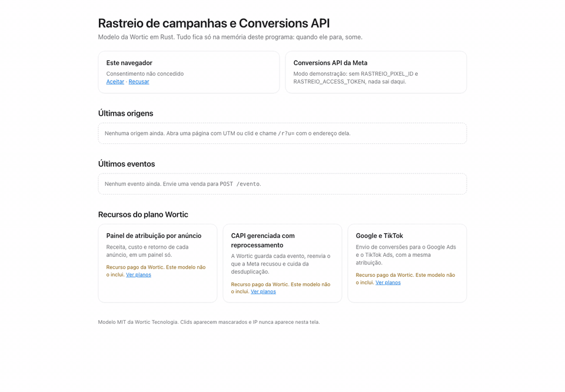
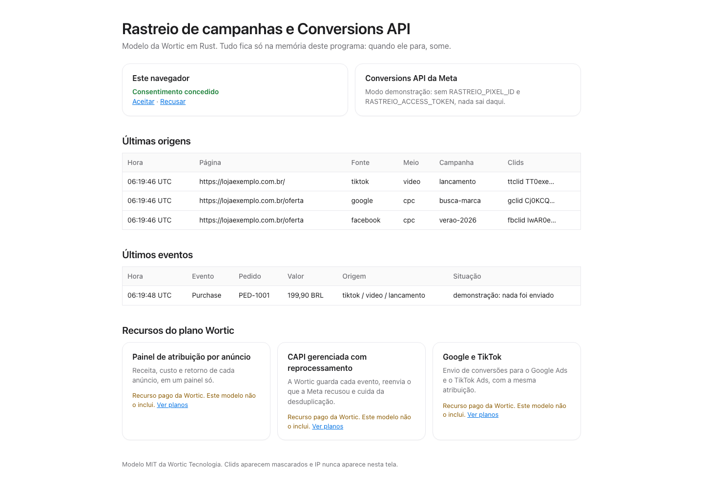
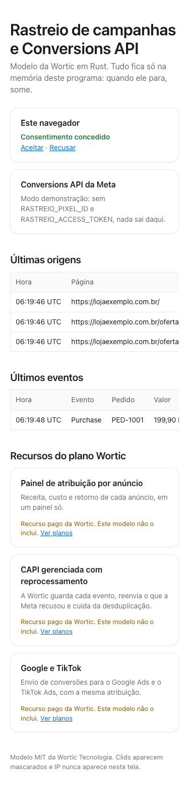

> **Este modelo mudou de casa.** Agora ele é a ferramenta `wortic rastreio` do projeto único
> [developer-wortic/ferramentas-rust](https://github.com/developer-wortic/ferramentas-rust) (pasta `crates/rastreio`), com o
> histórico deste repositório, um binário só para as quatro ferramentas e jsonW em tudo. Este repositório fica
> arquivado, só para leitura.
>
> *This template moved to [developer-wortic/ferramentas-rust](https://github.com/developer-wortic/ferramentas-rust)
> (`wortic rastreio`). This repository is archived.*

# Rastreio de campanhas e Conversions API da Meta em Rust

<!-- GIF -->


**Saiba qual anúncio fez a venda.** Uma biblioteca e um modelo em Rust que capturam UTM e clids (`fbclid`, `gclid`, `ttclid`, `msclkid`), guardam o primeiro e o último toque num cookie assinado, normalizam e fazem o hash dos dados do cliente como a Meta pede, e montam o evento da Conversions API com `event_id` para desduplicar com o Pixel. Sem banco. Sem serviço externo. Uso livre com créditos (licença AAL).

[](LICENSE)

[](https://github.com/developer-wortic/modelo-rastreio-capi-rust/actions/workflows/ci.yml)
Cobertura de linhas: 100%.

**[Ver planos da Wortic](https://wortic.com.br/planos)** para o painel de atribuição, a CAPI gerenciada e o envio ao Google e ao TikTok.

## Três provas que você pode conferir

1. **Os testes passam.** Rode `cargo test`. Hoje são 148 testes (144 unitários, 3 do binário e 1 exemplo de uso). A cobertura de linhas é de 100%: 3.001 linhas, todas cobertas.
2. **Os hashes batem com a Meta.** Os exemplos publicados pela própria Meta (`john_smith@gmail.com` vira `62a14e44…`, `16505551212` vira `e323ec62…`, `mary` vira `6915771b…`, `us` vira `79adb2a2…`) estão nos testes. O evento de exemplo da seção "Uso como biblioteca" gera esses mesmos quatro hashes.
3. **Sem chave, nada sai.** Rode o modelo sem `RASTREIO_PIXEL_ID` e sem `RASTREIO_ACCESS_TOKEN`. A venda volta com `"resultado":"demonstracao"`, mostra o evento montado e confirma que nada foi enviado à Meta.

## Início rápido

```sh
git clone https://github.com/developer-wortic/modelo-rastreio-capi-rust
cd modelo-rastreio-capi-rust
cargo run --release
```

Abra http://127.0.0.1:8080. A tela mostra o consentimento deste navegador, as últimas origens e os últimos eventos. Para ver dados, simule uma visita com anúncio e uma venda:

```sh
# visita de anúncio: o navegador precisa ter consentido (rc_consent=1)
curl -G --data-urlencode "u=https://loja.com.br/oferta?utm_source=facebook&utm_medium=cpc&utm_campaign=verao&fbclid=AbC123" \
  -H "Cookie: rc_consent=1" http://127.0.0.1:8080/r

# venda: o site envia o formulário com o cookie de atribuição
curl -X POST http://127.0.0.1:8080/evento \
  -H "Cookie: rc_consent=1; rc_atrib=<valor do Set-Cookie da visita>" \
  --data-urlencode "evento=Purchase" --data-urlencode "pedido=PED-1001" \
  --data-urlencode "valor=199,90" --data-urlencode "moeda=BRL" \
  --data-urlencode "u=https://loja.com.br/obrigado" --data-urlencode "email=ana@exemplo.com"
```

Sem `RASTREIO_PIXEL_ID` e `RASTREIO_ACCESS_TOKEN`, a resposta é o evento montado, em modo demonstração. Com os dois, o evento vai à Conversions API da Meta.

## Uso como biblioteca

O caminho de uma venda, da URL de entrada até o envio. O exemplo abaixo roda como teste (`cargo test`) e não faz rede:

```rust
use rastreio_capi::atribuicao::Atribuicao;
use rastreio_capi::captura::{self, Plataforma};
use rastreio_capi::cookie::Cookie;
use rastreio_capi::dados::Dados;
use rastreio_capi::evento::{self, Entrada, Nome};
use rastreio_capi::identificadores::{self, INDICE_PADRAO};

// 1. a visita chega com UTM e clid; a atribuição guarda o primeiro e o último toque
let agora_ms = 1_700_000_000_000;
let mut atribuicao = Atribuicao::default();
atribuicao.registrar(
    captura::de_url("https://loja.com.br/oferta?utm_source=facebook&fbclid=AbC123"),
    agora_ms,
);

// 2. o cookie é assinado: alterado ou vencido, não é lido
let cookie = Cookie::new(b"troque-por-um-segredo-com-32-bytes-ou-mais", 90).expect("chave");
let valor = cookie.gravar(&atribuicao);
let lida = cookie.ler(&valor, agora_ms + 1_000).expect("cookie válido");

// 3. na venda, o fbc vem do cookie _fbc ou do fbclid do último toque
let fbclid = lida.ultimo.as_ref().and_then(|toque| toque.captura.clid(Plataforma::Meta));
let fbc = identificadores::fbc_escolhido(None, fbclid, agora_ms, INDICE_PADRAO);

// 4. o evento sai em hash para o que é dado pessoal
let entrada = Entrada {
    nome: Nome::Purchase,
    event_id: "pedido-1001",
    momento_s: agora_ms / 1_000,
    agora_s: agora_ms / 1_000 + 5,
    pagina: "https://loja.com.br/obrigado?pedido=1001",
    dados: Dados {
        email: Some("Ana@Exemplo.com"),
        telefone: Some("(11) 91234-5678"),
        ..Dados::default()
    },
    ip: None,
    user_agent: None,
    fbc: fbc.as_deref(),
    fbp: None,
    valor_centavos: Some(19_990),
    moeda: Some("BRL"),
    ddi_padrao: "55",
    enviar_ip_e_user_agent: true,
};
let evento = evento::montar(&entrada).expect("evento");
```

O envio fica separado, porque é o único passo com rede. Ele só acontece com consentimento:

```rust,no_run
use rastreio_capi::envio::{Config, Envio};

let consentido = true; // o visitante aceitou o uso dos dados
let envio = Envio::nova(Config::nova("123456789012345", "TOKEN_DA_CONVERSIONS_API"))
    .expect("configuração");
let resultado = envio.enviar(consentido, &entrada);
```

`resultado` é `Enviado`, `Recusado` (sem consentimento), `Invalido` (o evento não cumpre a regra da Meta) ou `Falhou` (a Meta recusou, ou as tentativas acabaram).

### O evento que sai

Exemplo gerado pelo modelo com os dados de exemplo publicados pela própria Meta, com `RASTREIO_DDI=1`. Nenhum dado real. Os quatro hashes conferem com os vetores da documentação:

```text
{
  "action_source": "website",
  "custom_data": { "currency": "USD", "value": 100.2 },
  "event_id": "event.id.123",
  "event_name": "Purchase",
  "event_source_url": "http://jaspers-market.com/product/123",
  "user_data": {
    "client_ip_address": "127.0.0.1",
    "client_user_agent": "test ua",
    "country": ["79adb2a2fce5c6ba215fe5f27f532d4e7edbac4b6a5e09e1ef3a08084a904621"],
    "em": ["62a14e44f765419d10fea99367361a727c12365e2520f32218d505ed9aa0f62f"],
    "fbc": "fb.1.1554763741205.AbCdEfGhIjKlMnOpQrStUvWxYz1234567890",
    "fbp": "fb.1.1558571054389.1098115397",
    "fn": ["6915771be1c5aa0c886870b6951b03d7eafc121fea0e80a5ea83beb7c449f4ec"],
    "ph": ["e323ec626319ca94ee8bff2e4c87cf613be6ea19919ed1364124e16807ab3176"]
  },
  "event_time": 1794723811
}
```

A página sai sem a consulta (`?utm_source=...` não vai à Meta). O `event_time` é o do momento da venda.

## O que vem pronto

- **Captura de UTM e clids.** Lê `utm_source`, `utm_medium`, `utm_campaign`, `utm_content`, `utm_term` e os clids `fbclid`, `gclid`, `ttclid` e `msclkid`. Parâmetro repetido vale o primeiro. Valor com caractere de controle, longo demais ou fora do formato é descartado.
- **Primeiro e último toque.** Guardados num cookie `rc_atrib`, assinado com HMAC-SHA256, com prazo de 90 dias (configurável). Visita sem rastreio não troca nada.
- **`fbc` e `fbp` no formato da Meta.** `fb.{subdomínio}.{horário em ms}.{fbclid}`, com o cookie `_fbc` do Pixel na frente.
- **Dados do cliente normalizados e em hash SHA-256**, nas regras da Meta: `em`, `ph`, `fn`, `ln`, `db`, `ct`, `st`, `zp`, `country` e `external_id`. O dado cru nunca sai da biblioteca.
- **Evento completo.** `Purchase`, `Lead`, `InitiateCheckout` e `PageView`, com `event_id`, `action_source` `website`, `event_source_url` sem consulta e `custom_data` com valor e moeda.
- **Envio por HTTPS** com `test_event_code` para o Test Events da Meta, reenvio em 429, 5xx e falha de rede, e sem reenvio em 4xx.
- **Consentimento.** Sem consentimento, nada é montado com dado do cliente e nada é enviado. O motivo fica registrado.
- **Modelo pronto.** Um binário com o pixel primário (`/r`), a rota de venda (`/evento`), o consentimento (`/consentimento`) e a tela (`/`). Tudo em memória.

## Ganchos do plano Wortic (pagos)

Estes recursos aparecem na tela do modelo com o aviso e o link dos planos. Nada deles roda sem o plano.

| Recurso | O que faz | Aqui |
|---|---|---|
| Painel de atribuição por anúncio | Receita, custo e retorno de cada anúncio, em um painel só | Aviso e link: [wortic.com.br/planos](https://wortic.com.br/planos) |
| CAPI gerenciada com reprocessamento | A Wortic guarda cada evento, reenvia o que a Meta recusou e cuida da desduplicação | Aviso e link: [wortic.com.br/planos](https://wortic.com.br/planos) |
| Google e TikTok | Envio de conversões para o Google Ads e o TikTok Ads | Aviso e link: [wortic.com.br/planos](https://wortic.com.br/planos) |

Com `WORTIC_API_KEY` definida, o modelo mostra que a chave foi encontrada e não chama nada: a API de rastreio da Wortic não tem rota pública documentada. O valor da chave nunca é lido para a tela nem impresso.

O que este modelo faz de graça: a captura de `gclid` e `ttclid` já está na biblioteca. O envio dessas conversões ao Google e ao TikTok é o recurso pago.

## Rotas do modelo

| Rota | O que faz |
|---|---|
| `GET /` | A tela: consentimento, últimas origens, últimos eventos e os recursos pagos |
| `GET /r?u=<página>` | Pixel primário. Com consentimento e UTM ou clid em `u`, grava a origem e o cookie. Responde um GIF de 1 pixel |
| `POST /evento` | Recebe a venda em formulário (`evento`, `pedido`, `u`, `valor`, `moeda`, `email`, `telefone`, `nome`, `sobrenome`, `cidade`, `uf`, `cep`, `pais`, `nascimento`, `cliente`). Responde JSON |
| `GET /consentimento?aceitar=sim` ou `nao` | Grava a escolha do visitante e volta para a tela |

## Ajustes

Variáveis de ambiente. Valor vazio conta como ausente. Nenhum segredo ou token é impresso.

| Variável | Para quê | Padrão |
|---|---|---|
| `PORTA` | Porta do servidor | `8080` |
| `ENDERECO` | Endereço de escuta | `127.0.0.1` |
| `RASTREIO_SEGREDO` | Chave que assina o cookie (32 caracteres ou mais). Sem ela, a chave muda a cada início e os cookies antigos param de valer | gerada ao iniciar |
| `RASTREIO_PIXEL_ID` | ID do Pixel (só dígitos) | sem envio |
| `RASTREIO_ACCESS_TOKEN` | Token da Conversions API. Com ele e o Pixel, o modelo envia | sem envio |
| `RASTREIO_TEST_EVENT_CODE` | Código de teste da Events Manager (Test Events) | sem código |
| `RASTREIO_API_BASE` | Outra base da API, só para teste (`https`, ou `http` em `127.0.0.1` e `localhost`) | Graph API |
| `RASTREIO_DDI` | DDI que entra em telefone sem DDI | `55` |
| `RASTREIO_INDICE_SUBDOMINIO` | Índice do `fbc` quando o Pixel não gravou `_fbc` | `1` |
| `RASTREIO_PRAZO_DIAS` | Prazo do cookie de atribuição | `90` |
| `RASTREIO_MEMORIA` | Quantas origens e eventos ficam na tela | `200` |
| `RASTREIO_HTTPS` | `1` quando o site roda em HTTPS (liga o `Secure` no cookie) | desligado |
| `RASTREIO_SEM_IP_UA` | `1` tira IP e user agent do envio à Meta | desligado |
| `RASTREIO_MAX_PEDIDOS` | Para o programa depois de tantos pedidos (teste e smoke test) | sem limite |
| `WORTIC_API_KEY` | Só a presença é lida, para a tela mostrar o aviso dos recursos pagos | sem chave |

## Decisões que você precisa conhecer

- **Consentimento antes de tudo.** Sem `rc_consent=1`, o pixel não grava origem, a venda não monta evento com dado do cliente e nada vai à Meta. Esta biblioteca não decide a base legal; quem usa responde por ela.
- **IP e user agent contam como identificador.** A documentação da Meta lista os dois entre os parâmetros de `user_data`. Quando a sua base legal não cobrir isso, ligue `RASTREIO_SEM_IP_UA=1`. Sem IP, user agent, dado de contato, `fbc` e `fbp`, o evento não tem identificador e não é montado.
- **Telefone.** Sem `+` e sem `00`, um número de 10 ou 11 dígitos ganha o DDI padrão (`55`). Com `+` ou `00`, o DDI é o que foi digitado. Zeros à esquerda saem.
- **Nome e cidade.** Minúsculo, sem pontuação. Acento fica (a própria Meta usa `valéry` como exemplo). Cidade sem espaço (`sãopaulo`). CEP só com letras e números (`01310100`).
- **`fbc`.** Vem do cookie `_fbc` do Pixel quando ele existe. Senão, é montado do `fbclid` do último toque. Para domínio com sufixo como `.com.br`, confira no cookie `_fbc` que o Pixel grava qual é o índice de subdomínio e ajuste `RASTREIO_INDICE_SUBDOMINIO`.
- **Um evento por envio.** O modelo manda um evento por requisição. A Meta aceita até 1.000 por requisição; o lote não está implementado.
- **Desduplicação com o Pixel.** O `event_id` do evento precisa ser igual ao `eventID` que o Pixel do navegador envia para a mesma venda. O modelo não traz o trecho do Pixel; ele é do seu site.
- **Reenvio.** Até 3 tentativas no total, com espera de 1 segundo e depois 2 segundos. Se a Meta mandar `Retry-After`, a espera segue esse valor, com teto de 60 segundos. Erro 4xx (exceto 429) não é reenviado.
- **Janela de 7 dias.** A Meta recusa o lote inteiro se algum `event_time` passar de 7 dias. Venda mais antiga que isso não é montada.
- **Sem persistência.** A tela e a memória somem quando o programa para. Para guardar, troque a memória por um banco no seu sistema.

## Perguntas frequentes

**Como saber qual anúncio fez a venda, em Rust?**
Capture os parâmetros `utm_*` e os clids da URL de entrada com `captura::de_url`, guarde o primeiro e o último toque com `Atribuicao::registrar` num cookie assinado, e na venda monte o evento com `evento::montar`. O modelo deste repositório faz isso com `GET /r` e `POST /evento`.

**Funciona com a Conversions API da Meta?**
Sim. O evento segue o formato da documentação: `event_name`, `event_time`, `event_id`, `action_source`, `event_source_url`, `user_data` e `custom_data`. O envio vai para `graph.facebook.com/v27.0/{pixel}/events`, com `test_event_code` quando você configura.

**Os dados do cliente vão em claro para a Meta?**
Não. E-mail, telefone, nome, sobrenome, cidade, estado, CEP, país, data de nascimento e identificador do cliente vão em hash SHA-256, depois de normalizados. IP, user agent, `fbc` e `fbp` vão em claro, como a Meta exige para eles.

**Sem consentimento, o que acontece?**
Nada é montado com dado do cliente e nada é enviado. O resultado é `Recusado` com o motivo `sem_consentimento`, e o modelo mostra isso na tela.

**Dá para testar sem mandar nada para a Meta?**
Dá. Sem `RASTREIO_PIXEL_ID` e `RASTREIO_ACCESS_TOKEN`, o modelo fica em modo demonstração. Com `RASTREIO_TEST_EVENT_CODE`, o evento aparece na aba Test Events da Events Manager e conta para medição, então use-o só em teste.

**Por que o reenvio não acontece em erro 400?**
Porque 4xx quase sempre é problema do evento (formato, campo faltando, token errado). Repetir a mesma requisição não resolve e só gasta tempo. O motivo que a Meta devolveu fica no `Resultado::Falhou`, sem o token.

**Quais clids são capturados?**
`fbclid` (Meta), `gclid` (Google), `ttclid` (TikTok) e `msclkid` (Microsoft). O envio de conversão ao Google e ao TikTok é recurso pago da Wortic; a captura é grátis.

**Posso usar em produção?**
Use atrás de HTTPS, com `RASTREIO_SEGREDO` fixo, `RASTREIO_HTTPS=1` e com a sua política de privacidade. A biblioteca não guarda nada em disco; a memória do modelo é só para conferência. Antes de publicar, confira a base legal com seu jurídico. Este texto não é aconselhamento jurídico.

**Tem banco de dados?**
Não. A memória do modelo tem limite e some quando o programa para. O consumidor da biblioteca decide onde guardar.

## Testes e cobertura

```sh
cargo test                                  # testes unitários, do binário e o exemplo de uso
cargo llvm-cov --summary-only               # cobertura de linhas por arquivo
cargo fmt --check
cargo clippy -- -D warnings -W clippy::pedantic
```

Os testes não falam com a Meta. O envio é testado contra um servidor falso local, com 200, 400, 401, 429 (com reenvio), 500 (com reenvio), 503 e tempo esgotado. Os vetores de hash são os da documentação da Meta.

Cobertura de linhas: 100% (3.001 de 3.001, medido com `cargo llvm-cov` e cruzado linha a linha pelo LCOV). `cargo llvm-cov --summary-only` mostra o número de cada arquivo.

Cada push e cada pull request roda formatação, clippy (com o nível pedantic) e os testes no GitHub Actions. O arquivo está em `.github/workflows/ci.yml`.

## Privacidade e LGPD

- A biblioteca não grava nada em disco e não tem banco.
- O modelo guarda em memória as últimas origens e os últimos eventos, sem IP, sem e-mail, sem telefone e sem nome. A tela mostra clids mascarados (seis primeiros caracteres).
- Sem consentimento, nada de dado pessoal é montado nem enviado.
- A Meta recebe o dado do cliente só em hash, e IP e user agent só quando você deixa ligado.
- Pedido de correção ou remoção de dado: quem guarda o dado é o seu sistema. Este modelo não tem cadastro de pessoa.

## Prints





## Perguntas e contribuição

Veja [CONTRIBUTING.md](CONTRIBUTING.md) para contribuir e [SECURITY.md](SECURITY.md) para relatar falha de segurança.

## English

**Campaign tracking and Meta Conversions API in Rust.** A library and a small reference app that capture UTM parameters and click IDs (`fbclid`, `gclid`, `ttclid`, `msclkid`), keep the first and the last touch in a signed cookie (HMAC-SHA256, with expiry), normalize and SHA-256 hash the customer data the way Meta requires, and build a Conversions API event with an `event_id` to deduplicate it against the Pixel. No database, no external service. Sending happens only with consent, a Pixel ID and an access token; without them the app runs in demo mode and sends nothing. Run `cargo run --release` and open http://127.0.0.1:8080. Attribution Assurance License: free to use with credit to Wortic. Paid Wortic features (attribution dashboard, managed CAPI with reprocessing, Google and TikTok sending) appear in the UI with a notice and a link to https://wortic.com.br/planos.

## Licença

Licença AAL, de uso livre com créditos: use, mude e venda o seu sistema feito a partir deste modelo, mostrando "Feito com tecnologia Wortic (wortic.com.br)". Texto completo em [LICENSE](LICENSE).

---

**[Ver planos da Wortic](https://wortic.com.br/planos)**
